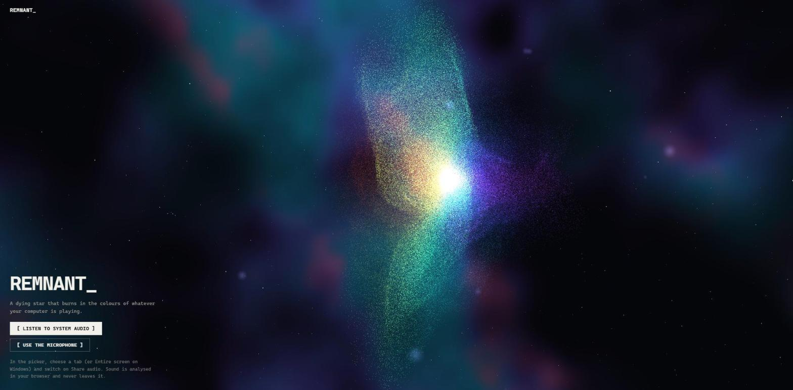

# Remnant

A dying star that burns in the colours of whatever your computer is playing.

**Live: https://momkay.github.io/remnant/**

Open the page, choose "Listen to system audio" (pick a tab, or Entire screen on Windows, and switch on Share audio) or the microphone. Sound is analysed in your browser and never leaves it.

- Bass is red on the left of the cloud, treble violet on the right, and every band lights its own patch of the shell.
- A gap in the beat makes the star collapse; the kick that ends it detonates it. Click the cloud to set one off yourself.
- Drag to orbit, scroll or pinch to zoom, double-click to reset.

Static files, no build step: `index.html` and `src/`, with Three.js vendored in `src/vendor/`. Needs https or localhost, a WebGL 2 browser and a decent GPU. Capturing a tab's audio works in Chrome and Edge; elsewhere use the microphone.
